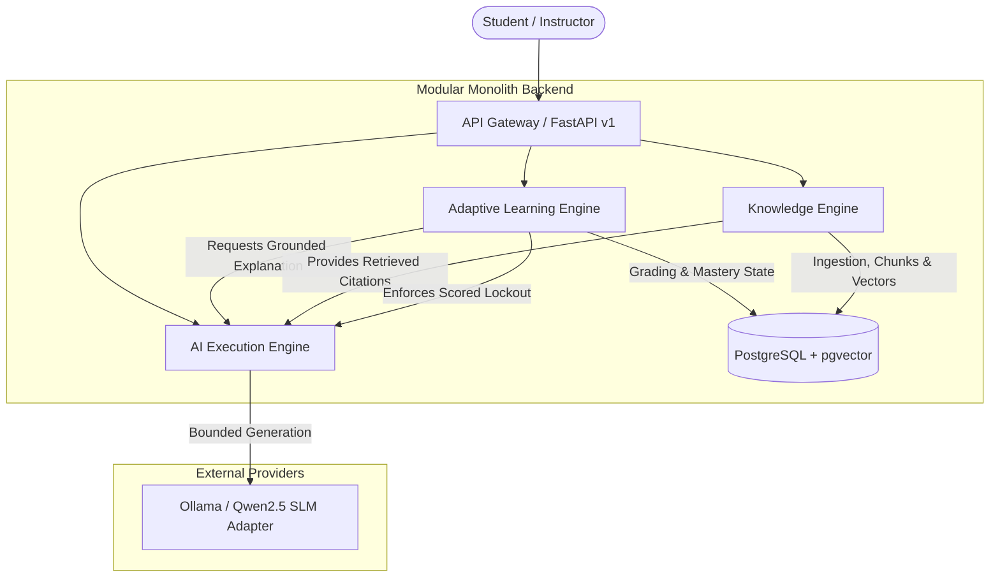

# Recall: Grounded Adaptive Learning Architecture

## 1. System Vision & Foundational Tenets
Recall is an institutional-grade adaptive learning platform designed to diagnose student mastery, deliver grounded revision, and systematically remediate student understanding without hallucination, unearned confidence leaps, or silent grade tampering.

### Non-Negotiable Architectural Principles
1. **Deterministic Authority**: All critical business decisions—including attempt eligibility, diagnostic routing, objective mastery scoring, confidence estimation, question grading, tutor locks, and spaced review scheduling—are computed deterministically by verified backend domain logic.
2. **Bounded AI Execution**: Large/Small Language Models (e.g., Qwen 2.5 via Ollama) are bounded text generators and synthesizers. The model is **never** permitted to override grading rubrics, modify user state, declare unverified mastery, or tutor students during scored assessments.
3. **Evidence-Confidence Decoupling**: Mastery (performance score $P \in [0, 1]$) and Evidence Confidence ($C \in [0, 1]$) are strictly separated. An incorrect answer with low confidence triggers targeted diagnostic exploration rather than topic-wide catastrophic degradation.
4. **Strict Grounding & Abstention**: The Knowledge Engine extracts and retrieves authentic curriculum chunks (PDF/PPT). If retrieval relevance fails to meet conservative confidence thresholds, the system explicitly abstains rather than synthesizing plausible hallucinations.
5. **Immutable Provenance**: Every question version, attempt submission, grading outcome, diagnostic recommendation, and tutor exchange is recorded immutably with cryptographic or temporal provenance.

---

## 2. Logical Engines

The Recall backend is structured as a **Modular Monolith** comprising three primary logical engines:

### A. Adaptive Learning Engine (ALE)
- **Domain Responsibilities**:
  - Course, Topic, and Granular Learning Objective (LO) hierarchies.
  - Prerequisite graph modeling (directed acyclic hypotheses, not causal certainties).
  - Versioned Question Bank with deterministic grading rubrics (e.g., Relational DBMS: Functional Dependencies, Armstrong's Axioms, BCNF, 3NF).
  - Attempt lifecycle: State machine ensuring single-submission idempotency, timing, and hint tracking.
  - Mastery & Evidence Estimation:
    - Performance score $P_k$ reflects accuracy on verified, independent questions.
    - Confidence score $C_k$ reflects sample breadth, recency, and absence of assistance.
    - Hint penalties: Attempts using hints are partitioned and discounted.
    - Repetition discount: Repeated questions do not yield fresh independent evidence.
  - Bounded Diagnostics: Strict upper bound on diagnostic questions (e.g., max 5 questions per session) to prevent learner exhaustion.
  - Recovery Routing: Rejection of diagnostic recommendations halts unhelpful loops and routes students to grounded revision or unscored practice.

### B. Knowledge Engine (KE)
- **Domain Responsibilities**:
  - Ingestion of lecture materials (PDF slides, PPT decks, syllabus guides).
  - Semantic chunking with preserved provenance (filename, slide/page number, heading, structural path).
  - pgvector dense vector embeddings combined with PostgreSQL full-text search (hybrid retrieval).
  - Grounding Verification: Retrieval similarity is treated as a candidate pool, not proof of factual support.
  - Grounded Context Assembly: Injects verifiable citations `[Doc: Page X]` for tutor explanations and review guides.
  - Abstention Protocol: Returns `UNVERIFIED_OR_INSUFFICIENT_EVIDENCE` when retrieved context is beneath semantic cutoff.

### C. AI Execution Engine (AEE)
- **Domain Responsibilities**:
  - Primary Small Language Model (SLM) Adapter (Ollama Qwen2.5 3B / configurable API fallback).
  - Strict JSON schema enforcement via Pydantic model validation.
  - Strict Timeout & Circuit Breaking (e.g., 15s deadline with graceful fallback to deterministic remediation).
  - Server-Side Scored Assessment Lockout: If a student is currently engaged in an active, timed, or scored diagnostic attempt, all free-form tutor queries for that student are blocked with `403 AssessmentLockoutError`.

---

## 3. Frozen Learning Rules

1. **Performance Score $\neq$ Evidence Confidence**:
   - $P_k \in [0.0, 1.0]$: Estimated probability of successful execution of objective $k$.
   - $C_k \in [0.0, 1.0]$: Statistical reliability of $P_k$ given sample volume, variance, time elapsed, and hint usage.
2. **Non-Catastrophic Diagnosis**:
   - A single failed item never triggers topic-wide weakness status; instead, it triggers a sub-objective probe.
3. **Non-Duplicate Evidence**:
   - Multiple attempts on identical question IDs do not inflate evidence volume.
4. **Hint Degradation**:
   - Scored questions attempted with hints cannot grant full mastery increment ($W_{\text{hint}} \le 0.35$).
5. **Hypothetical Prerequisites**:
   - Prerequisite edges are reviewed hypotheses; failure in a child node does not automatically impute failure to parent nodes without verification.
6. **Retention Separation**:
   - Retesting immediately after review measures working memory, not durable mastery; spaced review scheduling enforces delayed retention checks.
7. **Abstention Over Hallucination**:
   - When curriculum grounding is absent, the system must state that the syllabus does not contain sufficient material.

---

## 4. API & Data Contracts

- **API Versioning**: All production routes reside under `/api/v1`.
- **Error Standard**: RFC 7807 Problem Details envelope (`type`, `title`, `status`, `detail`, `instance`, `code`).
- **Idempotency**: Scored attempt submissions require an `Idempotency-Key` HTTP header. Replay submissions return the original recorded result without side effects.
- **Audit Provenance**: Every grading record preserves the submitted answer, evaluated rubric, question version ID, and timestamp.
