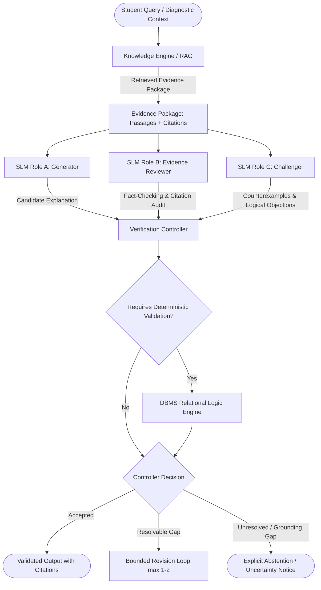

# Recall: Grounded Adaptive Learning Architecture

## 1. System Vision & Foundational Tenets
Recall is an institutional-grade adaptive learning platform designed to diagnose student mastery, deliver grounded revision, and systematically remediate student understanding without hallucination, unearned confidence leaps, or silent grade tampering.

### Non-Negotiable Architectural Principles
1. **Deterministic Authority**: All critical business decisions—including attempt eligibility, diagnostic routing, objective mastery scoring, confidence estimation, question grading, tutor locks, and spaced review scheduling—are computed deterministically by verified backend domain logic.
2. **Bounded AI Execution**: Large/Small Language Models (e.g., Qwen 2.5 via Ollama) are bounded text generators and synthesizers. The model is **never** permitted to override grading rubrics, modify user state, declare unverified mastery, or tutor students during scored assessments.
3. **Evidence-Confidence Decoupling**: Mastery (performance score $P \in [0, 1]$) and Evidence Confidence ($C \in [0, 1]$) are strictly separated. An incorrect answer with low confidence triggers targeted diagnostic exploration rather than topic-wide catastrophic degradation.
4. **Strict Grounding & Abstention**: The Knowledge Engine extracts and retrieves authentic curriculum chunks (PDF/PPT). If retrieval relevance fails to meet conservative confidence thresholds, the system explicitly abstains rather than synthesizing plausible hallucinations.
5. **Immutable Provenance**: Every question version, attempt submission, grading outcome, diagnostic recommendation, and tutor exchange is recorded immutably with cryptographic or temporal provenance.

---

## 2. Logical Engines

The Recall backend is structured as a **Modular Monolith** comprising three primary logical engines:

### A. Adaptive Learning Engine (ALE)
- **Domain Responsibilities**:
  - Course, Topic, and Granular Learning Objective (LO) hierarchies.
  - Prerequisite graph modeling (directed acyclic hypotheses, not causal certainties).
  - Versioned Question Bank with deterministic grading rubrics (e.g., Relational DBMS: Functional Dependencies, Armstrong's Axioms, BCNF, 3NF).
  - Attempt lifecycle: State machine ensuring single-submission idempotency, timing, and hint tracking.
  - Mastery & Evidence Estimation:
    - Performance score $P_k$ reflects accuracy on verified, independent questions.
    - Confidence score $C_k$ reflects sample breadth, recency, and absence of assistance.
    - Hint penalties: Attempts using hints are partitioned and discounted.
    - Repetition discount: Repeated questions do not yield fresh independent evidence.
  - Bounded Diagnostics: Strict upper bound on diagnostic questions (e.g., max 5 questions per session) to prevent learner exhaustion.
  - Recovery Routing: Rejection of diagnostic recommendations halts unhelpful loops and routes students to grounded revision or unscored practice.

### B. Knowledge Engine (KE)
- **Domain Responsibilities**:
  - Ingestion of lecture materials (PDF slides, PPT decks, syllabus guides).
  - Semantic chunking with preserved provenance (filename, slide/page number, heading, structural path).
  - pgvector dense vector embeddings combined with PostgreSQL full-text search (hybrid retrieval).
  - Grounding Verification: Retrieval similarity is treated as a candidate pool, not proof of factual support.
  - Grounded Context Assembly: Injects verifiable citations `[Doc: Page X]` for tutor explanations and review guides.
  - Abstention Protocol: Returns `UNVERIFIED_OR_INSUFFICIENT_EVIDENCE` when retrieved context is beneath semantic cutoff.

### C. AI Execution Engine (AEE)
- **Domain Responsibilities**:
  - Primary Small Language Model (SLM) Adapter (Ollama Qwen 2.5 3B baseline / configurable API fallback). [Status: `PARTIALLY IMPLEMENTED` - configuration keys present; inference client pending]
  - Collaborative SLM Verification Pipeline (Generator, Evidence Reviewer, Challenger roles). [Status: `PLANNED`]
  - Verification Controller with deterministic checks, bounded retries, and strict abstention. [Status: `PLANNED`]
  - Strict JSON schema enforcement via Pydantic model validation. [Status: `PLANNED`]
  - Strict Timeout & Circuit Breaking (e.g., 15s deadline with graceful fallback to deterministic remediation templates). [Status: `PARTIALLY IMPLEMENTED` - timeout setting configured]
  - Server-Side Scored Assessment Lockout: If a student is currently engaged in an active, timed, or scored diagnostic attempt, all free-form tutor queries for that student are blocked with `403 AssessmentLockoutError`. [Status: `PARTIALLY IMPLEMENTED` - exception defined; service integration pending]

---

## 3. Frozen Learning Rules

1. **Performance Score $\neq$ Evidence Confidence**:
   - $P_k \in [0.0, 1.0]$: Estimated probability of successful execution of objective $k$.
   - $C_k \in [0.0, 1.0]$: Statistical reliability of $P_k$ given sample volume, variance, time elapsed, and hint usage.
2. **Non-Catastrophic Diagnosis**:
   - A single failed item never triggers topic-wide weakness status; instead, it triggers a sub-objective probe.
3. **Non-Duplicate Evidence**:
   - Multiple attempts on identical question IDs do not inflate evidence volume.
4. **Hint Degradation**:
   - Scored questions attempted with hints cannot grant full mastery increment ($W_{\text{hint}} \le 0.35$).
5. **Hypothetical Prerequisites**:
   - Prerequisite edges are reviewed hypotheses; failure in a child node does not automatically impute failure to parent nodes without verification.
6. **Retention Separation**:
   - Retesting immediately after review measures working memory, not durable mastery; spaced review scheduling enforces delayed retention checks.
7. **Abstention Over Hallucination**:
   - When curriculum grounding is absent, the system must state that the syllabus does not contain sufficient material.

---

## 4. API & Data Contracts

- **API Versioning**: All production routes reside under `/api/v1`.
- **Error Standard**: RFC 7807 Problem Details envelope (`type`, `title`, `status`, `detail`, `instance`, `code`).
- **Idempotency**: Scored attempt submissions require an `Idempotency-Key` HTTP header. Replay submissions return the original recorded result without side effects.
- **Audit Provenance**: Every grading record preserves the submitted answer, evaluated rubric, question version ID, and timestamp.

---

## 5. Collaborative Small Language Model (SLM) Verification Architecture (Target Design & Evaluation Roadmap)

> **Implementation Note**: The components described in this section represent the intended target architecture for model-assisted generative features (explanations, hints, review summaries). As of Phase 2, this subsystem is **`PLANNED`** and not yet implemented in application source code.

### A. Rationale & Core Tenet
In institutional learning environments, relying on an unverified single-model response risks hallucinated curriculum claims, citation drift, sycophancy, and unchecked reasoning errors. Recall addresses this by designing a **collaborative verification architecture** leveraging multiple specialized, role-differentiated Small Language Models (SLMs) (with local Qwen 2.5 3B via Ollama as the baseline provider).

Instead of treating model outputs as authoritative, the architecture treats model generations as **unverified hypotheses** subjected to independent review, adversarial challenge, and deterministic validation.

### B. End-to-End Verification Pipeline

#### 1. Evidence Retrieval (Input Layer)
- **Inputs**: Student question or diagnostic prompt, active learning objective, verified question version metadata, and approved course material chunks.
- **Retrieval**: The Knowledge Engine/RAG layer retrieves authentic curriculum passages with verified structural identifiers (file, slide, page, heading).

#### 2. Role-Based Model Invocations
- **SLM Role A — Generator**:
  - Task: Synthesizes a candidate explanation, Socratic hint, or conceptual interpretation grounded strictly in the supplied evidence package.
- **SLM Role B — Evidence Reviewer**:
  - Task: Independently audits the candidate explanation against the retrieved course material. Identifies unsupported factual assertions, mismatched citations, hallucinations, and ungrounded extrapolations.
- **SLM Role C — Challenger**:
  - Task: Adversarially probes the explanation for counterexamples, boundary-condition failures, alternative interpretations, or invalid logical inferences.
- **Configurability**: Model assignments, quantization levels, and role topologies are configurable. Three roles represents the target design for complex conceptual explanations, but lightweight queries may invoke a single or dual-role configuration based on latency and resource budgets.

#### 3. Verification Controller
Collects structured JSON findings from all active roles and executes a deterministic decision tree:
1. **Accept**: If all claims are grounded in evidence citations and no valid logical contradictions remain, emit the response.
2. **Bounded Revision**: If the Reviewer or Challenger flags resolvable issues (e.g., imprecise citation or missing caveat), request a single bounded revision from the Generator with explicit critique context.
3. **Retrieve Additional Evidence**: If an ungrounded claim points to a verifiable concept, trigger targeted secondary retrieval from the Knowledge Engine.
4. **Deterministic Validation**: If the explanation involves formal computable structures (e.g., attribute closures, minimal covers, normal forms), invoke the deterministic backend domain engine (`dbms_engine.py`) to verify mathematical truth.
5. **Abstain**: If evidence is insufficient, contradictory, or cannot be verified within token/retry budgets, return a clear uncertainty response stating that course materials do not provide sufficient backing.

> **Critical Rule on Decision Authority**: The Verification Controller **strictly rejects raw majority voting**. A claim is not accepted merely because 2 of 3 roles agree. Grounded course evidence, independent citation verification, and deterministic logic override raw model consensus.

#### 4. Validated Output
Emits the grounded explanation containing explicit, clickable source citations `[Lecture: Slide X]`, or an authoritative abstention notice.

---

### C. Unbreachable Deterministic System Boundary

The collaborative SLM pipeline is strictly bounded to pedagogical explanations, Socratic hinting, and qualitative interpretation. It holds **zero authority** over core business logic.

The backend repository, service architecture, and accepted ADRs remain the sole source of truth for:
- **Scoring & Grading**: Deterministic Python algorithms compute 100% of grades. No model assigns points or alters answer keys.
- **Attempt History & Idempotency**: Immutable attempt ledger entries, version hashes, and cryptographic replay detection.
- **Evidence Eligibility**: Only verified, independent, unassisted attempts contribute to learner mastery.
- **Mastery State Machine**: Decoupled Performance ($P_k$) and Confidence ($C_k$) metrics, state transitions (`UNTESTED`, `DEVELOPING`, `MASTERED`, etc.), and volume caps.
- **Remediation & Review Schedules**: Spaced retention intervals, diagnostic route limits, and prerequisite gating.
- **Security & Authorization**: Assessment lockouts (`403 AssessmentLockoutError`) strictly preventing generative model access during active scored assessments.

For formal computer science concepts (such as DBMS Functional Dependencies and Normalization), deterministic algorithms and known-answer suites are used directly rather than delegating correctness to language models.

---

### D. Implementation Components & Engineering Dependencies (Future Scope)

When implemented in a future phase, the collaborative SLM pipeline will require the following modular components:

1. **Model Adapter Layer**: Common async inference interface, Ollama client integration, model routing, strict JSON schema validation, timeout handling (15s default), and retry policies.
2. **Role-Based Orchestration**: Pipeline coordinating the execution of Generator, Reviewer, and Challenger prompts.
3. **Evidence Package Assembler**: Packaging student query, retrieved text passages, slide metadata, and output schema into structured prompts.
4. **Verification Controller**: Decision engine parsing structured findings, resolving critiques, dispatching deterministic checks, and triggering bounded revisions or abstentions.
5. **Resource & Latency Controls**: Hard caps on maximum model calls per query, token budgets, timeout circuit-breakers, and fallbacks to deterministic remediation templates.
6. **Evaluation Harness**: Automated framework benchmarking multi-SLM configurations against single-model baselines.

---

### E. Evaluation Methodology & Unproven Performance Hypothesis

To validate whether multi-SLM collaboration provides measurable pedagogical benefits over simpler architectures, the platform roadmap defines a formal comparative evaluation methodology.

#### Comparative Configurations
Using identical Recall-specific test sets and course slide corpora, four configurations will be compared:
- **Configuration A (Single SLM Baseline)**: One model generating answers without verification.
- **Configuration B (Self-Reflective Baseline)**: One model generating answers followed by self-review/refinement.
- **Configuration C (Dual-Role Pipeline)**: Generator model paired with an independent Evidence Reviewer.
- **Configuration D (Triad Pipeline)**: Generator, independent Evidence Reviewer, and independent Challenger.

#### Evaluation Metrics
1. **Answer Correctness**: Factual accuracy on domain concept benchmarks.
2. **Source Grounding & Citation Accuracy**: Precision of citations relative to actual slide contents.
3. **Unsupported Claim Rate**: Proportion of statements lacking explicit curriculum evidence.
4. **Error Detection & Correction Rate**: Ability of reviewer/challenger to catch and repair introduced errors.
5. **Robustness to Misleading / Incomplete Evidence**: Graceful abstention when given adversarial or partial context.
6. **End-to-End Latency**: Wall-clock response times across configurations.
7. **Compute & Token Footprint**: Total input/output tokens and local GPU/CPU memory consumption.
8. **Failure & Abstention Rates**: Frequency of timeouts, schema validation failures, and justifiable abstentions.

#### Unproven Hypothesis Disclaimer
> **Empirical Hypothesis Only**: The pedagogical and accuracy advantages of multi-SLM collaborative verification represent an **unproven hypothesis awaiting formal evaluation**. Recall does not claim parity with frontier foundation models, nor does it claim verified accuracy improvements, until empirical benchmark results across Configurations A through D are measured and documented on Recall course corpora.

