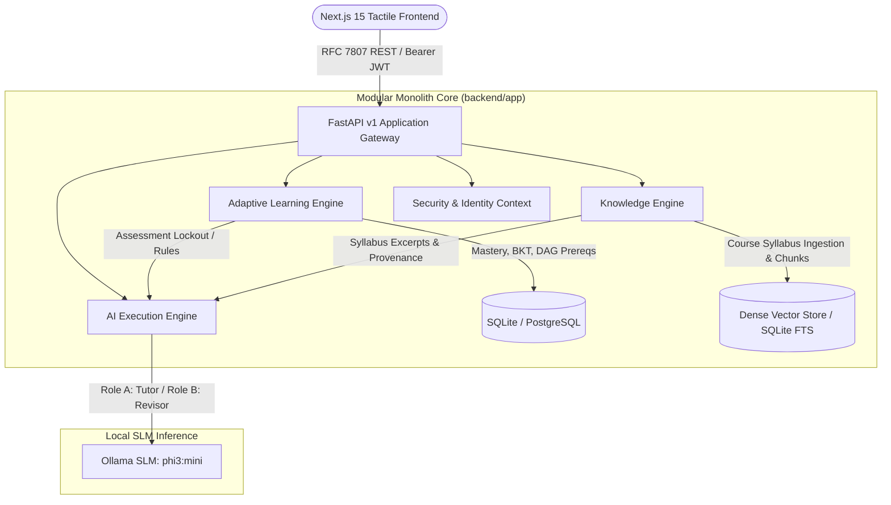

# Recall: System Architecture Specification

> **Canonical Document Reference:** For the complete in-depth architectural narrative, engine definitions, and mathematical models, refer to [ARCHITECTURE.md](file:///c:/Users/SOMESH%20BHARATHWAJ/Documents/AIML/projects/Genesis_Hackathon/Genesis_Hackathon/docs/architecture/ARCHITECTURE.md).

## 1. High-Level Modular Monolith Topology

Recall is architectured as an institutional-grade adaptive learning platform combining deterministic pedagogical intelligence with bounded local SLM execution.

## 2. Engine Responsibilities

| Engine | Primary Responsibilities | Core Invariants |
| :--- | :--- | :--- |
| **Adaptive Learning Engine (ALE)** | Curriculum DAG, versioned question bank, deterministic DBMS grader, BKT mastery engine, bounded diagnostic sessions ($\le 5$ items), spaced retention review queue. | **Zero Generative Scoring:** All grading and mastery progression is computed by deterministic algorithms (ADR 0002). |
| **Knowledge Engine (KE)** | Repeat-safe lecture ingestion (PDF, DOCX, PPTX, TXT, MD), page-provenance chunking, course-isolated vector retrieval sandbox. | **Tenant Isolation & Provenance:** Chunks never cross course boundaries; citations retain exact page and filename metadata. |
| **AI Execution Engine (AEE)** | Grounded AI Tutor (Role A) and Grounded Revisor (Role B) SLM adapters, prompt assemblers, and output sanitizers. | **Assessment Lockout:** Scored assessment checkpoints disable tutor and revisor access (`403 AssessmentLockoutError`). Strict abstention when evidence is insufficient. |
| **Security & Identity** | RFC 7807 error modeling, Bearer JWT authentication, role-based access control (`student`, `instructor`, `admin`), student ownership verification. | **Zero Client Trust:** Student ID in route bodies is verified against token claims; instructors/admins cannot be impersonated. |

## 3. Architectural Decision Records (ADRs)

- [ADR 0001: Modular Monolith Architecture](file:///c:/Users/SOMESH%20BHARATHWAJ/Documents/AIML/projects/Genesis_Hackathon/Genesis_Hackathon/docs/adr/0001-modular-monolith-architecture.md)
- [ADR 0002: Deterministic Adaptive Learning Engine](file:///c:/Users/SOMESH%20BHARATHWAJ/Documents/AIML/projects/Genesis_Hackathon/Genesis_Hackathon/docs/adr/0002-deterministic-adaptive-learning-engine.md)
